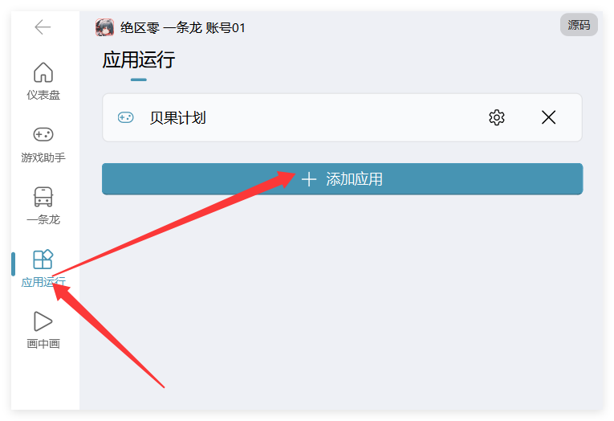
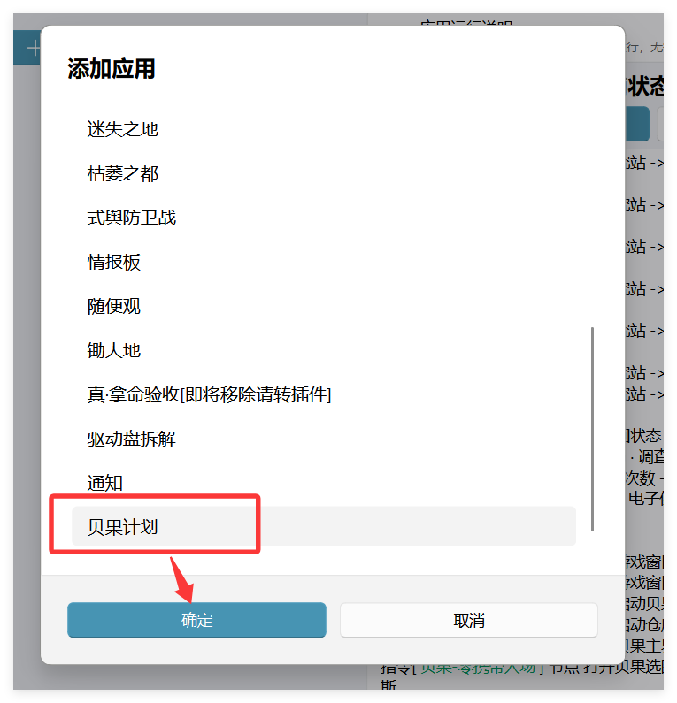
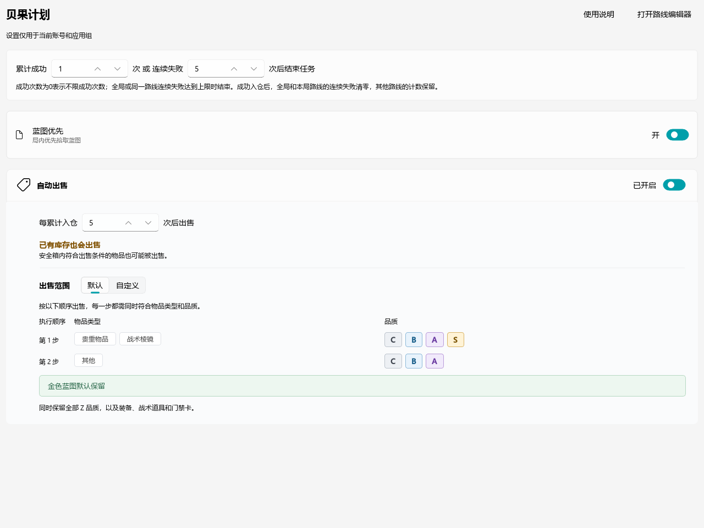
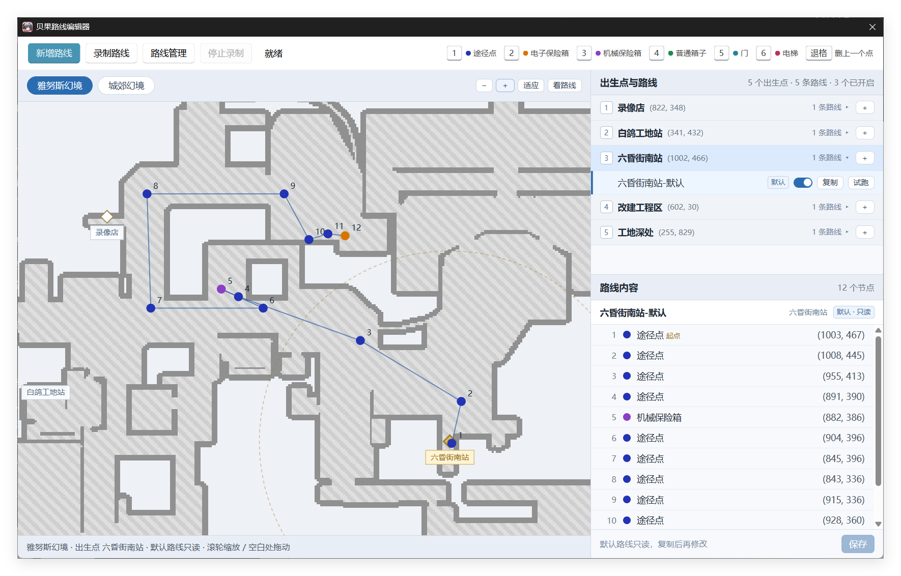

# Operation Bagel

[简体中文](README.md) | English

Automated Loot Run for Operation Bagel. It installs as a plugin, starts on its own from "Run Applications", and supports custom routes.

[If you find the plugin useful, a GitHub Star is welcome ⭐↗](https://github.com/Cora093/zzz-bagel-plugin)

## Installation

1. In the left navigation open "Run Applications" and click "Add application".
   
2. Find "Operation Bagel (macOS)" in the list, select it and click "OK".
   

## Settings

- **Stop after … successes**: the task ends once this many rounds have succeeded. Enter 0 to keep looping until the warehouse is full.
- **… consecutive failures**: default 5, range 1–10. When the global count, or the count of one route, reaches this number, the program finishes settlement, stops and leaves the scene in place; enter 1 to stop after the first failed round has been settled. After a successful deposit, the global count and the count of the route used in that round reset; the counts of other routes are kept. Empty-briefcase rounds and unsupported spawn points do not change the counts.
- **Difficulty**: Standard, Hard or High-Risk, default High-Risk. When you pick Hard or Standard, enable "Random Play-Non-High-Risk" and "Dove Street Construction Site Station-Non-High-Risk" in the route editor and disable the other spawn points; the program does not switch routes for you. High-Risk routes can get stuck on assist supplies at these two difficulties, and when talents are not maxed, HP after unloading gear may not last through the longer routes.
- **Blueprint priority**: when on, blueprints are picked up first during the run.
- **Auto-sell**: sells automatically once after every N deposits ("Sell after every N deposits"). Note that "Existing stock will also be sold": items in the safe that match the sell scope are sold too.
- **Sell scope**: steps run in order, and each step needs both an item type and a quality to match. The default has two steps: first C/B/A/S "Valuables + Tactical Prism", then C/B/A "Others". To define your own, switch to "Custom".

After an upgrade, the old cumulative-failure retry setting is no longer read; the consecutive-failure limit defaults to 5 and can be adjusted again on the settings page.

## Routes

Apart from routes, this app needs nothing from you; **the route decides how much you get per round**.

### Why the preset routes are conservative

The 5 High-Risk Loot Run default routes shipped with the plugin were recorded with the goal "anyone can finish them": more waypoints, narrow spots avoided, and an extra step rather than gambling on hugging a wall.
The person who recorded them used a different character, movement speed and account progress than you; somewhere they dared to dash, you may get stuck.

So the presets only get you running right away. For higher efficiency, record a route of your own:

- If your character is fast, spread the waypoints on long straight stretches farther apart.
- If you know where the boxes are, take a route through denser box areas.
- If you want to focus on safes, cut every unrelated box from the route.

### Record your own route

1. Click "Open route editor" at the top right of the app card.
   
2. Click "Record route", pick a spawn point, and the game comes to the foreground automatically.
3. **Stand on the spawn point and press `1` to place the first waypoint**. The first point must be inside that spawn point's recognition radius, otherwise the route cannot bind to this spawn point.
4. Walk to the next position and press the matching number to place a point:

   | Key | Point type |
   | --- | --- |
   | `1` | Waypoint |
   | `2` | Electronic Safe |
   | `3` | Mechanical Safe |
   | `4` | Normal Box |
   | `5` | Door |
   | `6` | Elevator |

5. If you misplace one, press `Backspace` to remove the last point.
6. Click "Stop recording" to save.

A route stores only coordinates and point types, not actions. Whether to open a box or interact when you reach a point is decided on the spot by recognizing the screen, so the closer the route is to how you actually walk, the smoother the run.

### Editing and test runs

In "Spawn points and routes" on the right, each spawn point has its routes listed under it.

- Default routes are read-only: click "Copy" to get your own copy and edit that. In a copy you can freely drag nodes, insert points and delete points.
- On the map, scroll to zoom and drag on empty space to pan; click "Fit" to bring the whole route into view.
- After editing, click "Test run": the program switches to the game and walks the route once, without continuing into settlement. Use it first to check that the route works.
- Each spawn point can have only one route enabled at a time (the switch on the right).

### What if a spawn point has no preset route

The Loot Run preset routes cover 5 spawn points, and only 3 of them are enabled automatically on a fresh install (Random Play, Dove Street Construction Site Station, Six Dusk Street South Station); the other two are off by default. The Suburbs Illusion spawn points are used by Keycard Run; see the next section for those routes.

### Keycard Run default routes

The plugin ships default routes for the Windworn Highway Motel, 2F, the Bunless Bae Town Cheezburg Bistro and the Bunless Bae Town Storage Center, 2F Prefab Building: 3 room segments and 6 entry segments in total. They are enabled automatically on first use; on upgrade, all default segments are also enabled for rooms that are not configured yet. Rooms where you already chose a route or explicitly turned it off keep their settings.

The motel supports the Windworn Highway_High and Windworn Highway_Low spawn points; the bistro and the prefab building support the Bunless Bae Town_East and Bunless Bae Town_West spawn points. Drawing a spawn point whose entry segment is not enabled makes the program exit and reroll. Default segments are read-only; copy them to modify. For the full list and the rules see [Keycard Run default routes](docs/keycard.md#默认路线).

## Share your route

If you record a route that is both fast and stable, you are welcome to open a PR in the repository that hosts this plugin so it can become someone else's default route.

What to submit:

1. Put the route file in `bagel_mac/assets/game_data/bagel/routes/`; the file name must be `<route_id>.sample.route.json` (the program checks that the file name matches `route_id`).
2. Change both `route_id` and `name` to something distinctive, for example `录像店-速刷` (shown as "Random Play-速刷" in the English UI; names stay Chinese in the files). **Do not use the `custom_` prefix**: that is the identifier format of local custom routes, and when a user clicks "Copy" on a route with that prefix it is validated as a custom identifier, so a Chinese name that does not match raises an error right away.
3. If a Loot Run route should be enabled when a new user starts for the first time, set `initial_route` for the matching spawn point in `bagel_mac/assets/game_data/bagel/spawn_points.yml`. Keycard Run segments are registered in `initial_room_route` and `initial_entry_routes` in `bagel_mac/assets/game_data/bagel/keycard_rooms.yml`; rooms not yet configured after a fresh install or upgrade are enabled automatically, and the rules are in [Keycard Run](docs/keycard.md#默认路线). Routes that should not be enabled automatically are not registered.

In the PR please state: the spawn point used, the key points of the path (why it detours), what progress level and characters it suits, and roughly how many boxes it opens. Screenshots or recordings are even better.

## Where files live

| Content | Location |
| --- | --- |
| Default routes (read-only, shipped with the plugin) | `bagel_mac/assets/game_data/bagel/routes/` |
| Spawn point list | `bagel_mac/assets/game_data/bagel/spawn_points.yml` |
| Your copied custom routes | working directory `plugin_data/bagel_mac/routes/custom_*.route.json` |
| The route currently enabled for each spawn point | working directory `plugin_data/bagel_mac/route_settings.yml` |
| Route data records (kept 7 days) | working directory `plugin_data/bagel_mac/route_records.jsonl` |
| Failure scene screenshots (kept 3 days, at most 500 MB in total) | working directory `plugin_data/bagel_mac/screenshots/` |

All runtime data lives under `plugin_data/bagel_mac/` in the working directory, separate from the plugin directory: a plugin upgrade replaces the whole plugin directory, so data inside it would be deleted with it, while data outside is safe. Default routes are inside the plugin, shipped with it, and read-only.

## FAQ

**Startup fails with "<map> has no enabled Loot Run routes; the task cannot start."**
Open the route editor and enable a route for a spawn point. Right after installation only 3 spawn points are enabled automatically.

**Default routes cannot be edited**
They are read-only. Click "Copy" and edit the copy.

**Custom routes disappeared after changing the working directory**
Custom routes are stored under `plugin_data/bagel_mac/routes/` in the working directory; before changing directories, copy the whole `plugin_data/bagel_mac/` over.

**The run keeps getting stuck on wall corners**
This is a different case from conservative routes: your character moves faster than the one used to record the route. Spread the waypoints on long straight stretches a little farther apart, or add one more point before the corner.

## Sources and license

The main program upstream is OneDragon-Anything/ZenlessZoneZero-OneDragon.

This repository is licensed under GNU GPL v3. Code migrated in later keeps its original copyright and license notices, and the sources of code and assets are recorded.
